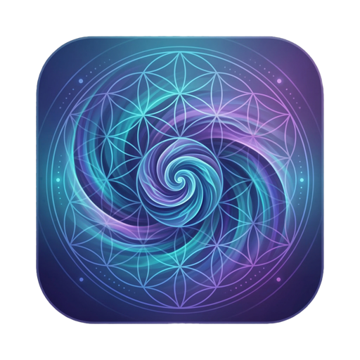
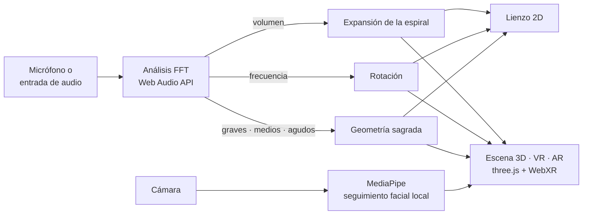

# 🌌 Audiomorphic
### Motor Audiovisual Sinestésico · Recurrencia Compleja & Realidad Virtual / Aumentada

**Convierte el sonido en geometría sagrada viva: en tu pantalla, en realidad virtual y sobre tu propio espacio en realidad aumentada.**

[**Abrir en la web**](https://audiomorphic.vercel.app) · [**Descargas**](#descargas) · [**Cómo funciona**](#cómo-funciona) · [**Ecosistema StarSeed**](#ecosistema-starseed)

> **In short (English):** Audiomorphic is a real-time audio visualizer that turns sound into living sacred geometry. Volume expands the spiral, frequency rotates it, and bass, mids and treble shape 20 geometry modes. It runs 100% offline from launch in the browser, as desktop and Android apps, in VR (WebXR) and in AR with your camera. Free to use, with or without an account. Part of the StarSeed ecosystem: it also runs inside [StarSeed OS](https://starseed-os.vercel.app). [Latest release](https://github.com/StarSeedSystem/Audiomorphic-AR-app/releases/latest).

---

## 🌟 Características Principales

- **100% Gratuito y Soberano (0% Paywalls):** Todas las geometrías (Flor de la Vida, Metatrón, Espiral Áurea, Fractales), pilotos automáticos y modos inmersivos están desbloqueados para todo el mundo sin suscripciones obligatorias.
- **100% Autónomo y Offline:** La suite arranca y funciona completamente fuera de línea desde el primer instante de instalación, sin scripts bloqueantes de CDN ni conexiones obligatorias a internet.
- **Análisis Espectral FFT en Vivo:** Separación continua de frecuencias en bajos (dilatación Yang), medios (modulación torsional) y agudos (velocidad fotónica y brillo espectral).
- **Piloto Automático Inteligente:** Modos autónomos *Génesis Geométrico*, *Arquitectura Armónica* y *Deriva Total* para sesiones meditativas e inmersivas sin intervención manual.
- **Realidad Virtual (VR 3D) & Realidad Aumentada (AR):** Soporte nativo para visores WebXR (Meta Quest, Apple Vision Pro, SteamVR) y cámaras de dispositivos para proyectar la geometría armónica en tu espacio físico.
- **Pantalla Siempre Activa (Wake Lock):** Evita la suspensión o bloqueo de la pantalla durante sesiones prolongadas de escucha y visualización.
- **Ruteo de Salida de Audio:** Selector de dispositivo de salida y micrófono de alta precisión en tiempo real.
- **Identidad Soberana & Presets StarSeed OS:** Sincronización bidireccional en la nube con [StarSeed OS](https://starseed-os.vercel.app) para guardar y compartir configuraciones.

---

## 📥 Descargas Oficiales por Sistema Operativo

> [!TIP]
> **Última Versión Oficial:** `v1.2.1` (Compilación 2026.10) · 100% Autónoma y funcional fuera de línea con aceleración por GPU.

| Sistema | Archivo / Formato | Tamaño | Enlace de Descarga Directa |
|---|---|---|---|
| **🤖 Android 6.0 o sup.** | Paquete APK Nativo (`.apk`) | 5,6 MB | [⬇️ Descargar APK Oficial (.apk)](https://github.com/StarSeedSystem/Audiomorphic-AR-app/releases/download/v1.2.1/Audiomorphic_v1.2.1.apk) |
| **🍎 macOS (Apple Silicon)** | Imagen de Disco (`.dmg`) | ~238 MB | [⬇️ Descargar Apple Silicon (.dmg)](https://github.com/StarSeedSystem/Audiomorphic-AR-app/releases/download/v1.2.1/Audiomorphic_v1.2.1_macOS_arm64.dmg) |
| **🍎 macOS Universal** | Archivo `.zip` con DMG | ~237 MB | [⬇️ Descargar Mac Universal (.zip)](https://github.com/StarSeedSystem/Audiomorphic-AR-app/releases/download/v1.2.1/audiomorphic-mac.zip) |
| **🪟 Windows 10 / 11** | Paquete Portable (`.zip`) | ~162 MB | [⬇️ Descargar Windows (.zip)](https://github.com/StarSeedSystem/Audiomorphic-AR-app/releases/download/v1.2.1/Audiomorphic_v1.2.1_Windows.zip) |
| **🐧 Linux x64** | Paquete Portable (`.tar.gz`) | ~774 MB | [⬇️ Descargar Linux x64 (.tar.gz)](https://github.com/StarSeedSystem/Audiomorphic-AR-app/releases/download/v1.2.1/Audiomorphic_v1.2.1_Linux_x64.tar.gz) |
| **🐧 Linux ARM64** | Paquete Portable (`.tar.gz`) | ~694 MB | [⬇️ Descargar Linux ARM64 (.tar.gz)](https://github.com/StarSeedSystem/Audiomorphic-AR-app/releases/download/v1.2.1/Audiomorphic_v1.2.1_Linux_arm64.tar.gz) |
| **🌐 Web App / PWA** | Web Progresiva Instalable | En vivo | [🚀 Abrir Web App Soberana](https://audiomorphic.vercel.app) |
| **☁️ Espejo Drive** | Carpeta Oficial en Google Drive | Universal | [☁️ Carpeta de Instaladores Mirror](https://drive.google.com/drive/folders/1bZ8yvbWr7r3eJUdKIQCSSuu-p398mAkn?usp=sharing) |

**Primera apertura.** Los binarios son portables y no requieren certificados comerciales: en macOS haz clic derecho → **Abrir**; en Windows, **Más información → Ejecutar de todas formas**. Hay además un [espejo en Google Drive](https://drive.google.com/drive/folders/1bZ8yvbWr7r3eJUdKIQCSSuu-p398mAkn?usp=sharing) por si GitHub experimenta congestión.

---

## 🔒 Guía de Permisos Nativos por Sistema Operativo

Audiomorphic requiere acceso a interfaces de hardware específicas para generar la sinestesia en tiempo real:

### 🐧 Linux (Ubuntu, Debian, Fedora, Arch, SteamOS)
1. **Ejecución Portable:** Descomprime con `tar -xzf Audiomorphic_v1.2.1_Linux_x64.tar.gz` y ejecuta `./audiomorphic.sh` o `./audiomorphic`.
2. **Pantalla Completa Inmersiva:** La aplicación se abre por defecto en modo pantalla completa cubriendo la barra superior del entorno (GNOME, KDE Plasma, XFCE). Puedes alternar con `F11` o la tecla `Escape`.
3. **Audio (ALSA, PulseAudio y PipeWire):** Soporta enrutamiento dinámico de salidas de audio a través de `select-audio-output` y captura de audio de escritorio mediante `WebRTCPipeWireCapturer` en sesiones Wayland y X11.
4. **Cámara y AR:** Compatible con dispositivos V4L2 (`/dev/video*`) para tracking de realidad aumentada.

### 🍎 macOS
1. **Micrófono:** Al abrir la app por primera vez, pulsa **"Permitir"** en el cuadro de diálogo de macOS. Si lo denegaste por error, ve a *Ajustes del Sistema → Privacidad y Seguridad → Micrófono* y activa la casilla de **Audiomorphic**.
2. **Cámara (Modos AR):** Requerida únicamente si activas la Realidad Aumentada para superponer la espiral sobre tu entorno. Se gestiona en *Ajustes del Sistema → Privacidad y Seguridad → Cámara*.
3. **Pantalla Completa:** Inicia en pantalla completa total y puedes alternar con `F11` o el atajo de pantalla completa.

### 🪟 Windows
1. **Micrófono:** Ve a *Configuración de Windows → Privacidad y Seguridad → Micrófono* y asegúrate de que esté habilitada la opción *"Permitir que las aplicaciones de escritorio accedan al micrófono"*.
2. **Aceleración por Hardware:** Asegúrate de tener actualizados los controladores de tu tarjeta gráfica (NVIDIA, AMD o Intel) para renderizar la espiral fractal a 60/120 FPS.
3. **Pantalla Completa:** Inicia cubriendo la barra de tareas y ventana completa; presiona `F11` para alternar.

---

## Cómo funciona

- **Espiral ↔ volumen.** La espiral se dibuja como una recurrencia compleja: cuanto más fuerte suena, más se expande y más gruesa es su línea. En silencio conserva un pulso mínimo para no apagarse.
- **Rotación ↔ frecuencia.** La frecuencia dominante aumenta el ángulo que gira cada paso de la recurrencia: los agudos retuercen la espiral más que los graves. Con el color armónico activado, la frecuencia también cambia el tono.
- **Bandas ↔ movimiento.** Con el piloto automático, los graves engrosan y expanden la espiral, los medios la hacen girar y los agudos la hacen vibrar; las figuras de geometría sagrada se superponen y respiran con el volumen.
- **AR y VR.** La escena 3D (React Three Fiber) entra en VR o AR mediante WebXR. En modo Portal, MediaPipe localiza tu cara con la cámara frontal y mueve la perspectiva como si miraras por una ventana.

El motor sigue el *Tratado de Unificación Armónica*: con α = V/2 (estructura) y β = √E (tensión), el régimen primario (α ≥ β) expande y el recíproco (α < β) contrae; un factor de cierre fractal mantiene la espiral estable en pantalla.

**Stack:** React 19 · Vite 6 · TypeScript · Tailwind CSS · three.js · React Three Fiber 9 · @react-three/xr (WebXR) · MediaPipe Tasks Vision · Supabase · PWA · Electron 41 · Capacitor (Android e iOS).

---

## Privacidad y seguridad

- **Micrófono.** El audio se analiza en tu dispositivo, fotograma a fotograma; nunca se graba ni se envía a ningún servidor.
- **Cámara.** Solo se enciende en los modos AR o Portal. MediaPipe procesa la imagen en tu dispositivo localmente.
- **Ajustes y presets.** Se guardan en tu navegador/dispositivo. Si inicias sesión con tu cuenta de StarSeed (opcional), tus presets se sincronizan con ella a través de Supabase.
- **Sin publicidad ni analítica.**

---

## Ecosistema StarSeed

- **[StarSeed OS](https://starseed-os.vercel.app)**: el sistema operativo social descentralizado. Audiomorphic también funciona **dentro** de StarSeed OS.
- **[Omnifrecuencias](https://omnifrecuencias.vercel.app)**: generador de frecuencias con cimática 3D y sesiones en vivo.
- **[Fundación StarSeed](https://linktr.ee/FundacionStarseed)**: comunidad y proyectos.

Creado por Alex Bordón Garrigós y la comunidad StarSeed.

